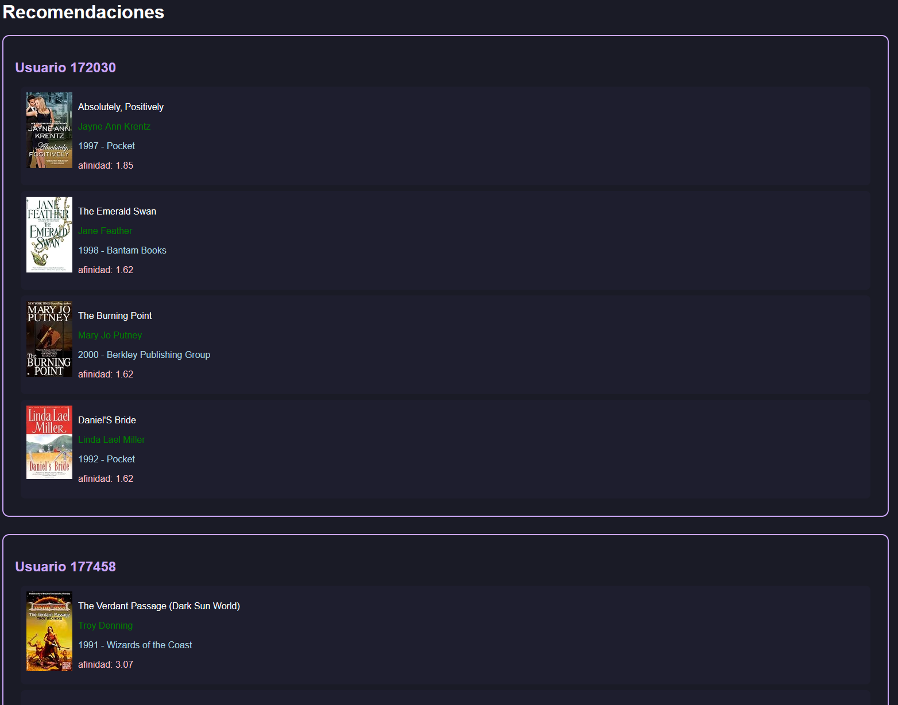

# Recomendador de libros con KNN

Sistema de recomendación de libros basado en **filtrado colaborativo item-item**, desarrollado como prueba técnica de acceso.

**Enunciado:** crear un sistema de recomendación de libros y validarlo mostrando las recomendaciones para 3 o 4 usuarios concretos.

## Cómo funciona

1. **Limpieza y análisis exploratorio** de los tres ficheros del dataset:
   - *Libros*: relleno de los pocos nulos (autor, editorial, imagen) con valores genéricos.
   - *Puntuaciones*: sin nulos; histograma de la distribución de notas.
   - *Usuarios*: 110.762 edades nulas y cientos de edades imposibles. Se recortan por percentiles (16-88 años) y los nulos se rellenan con la moda.
2. **Filtrado** para reducir ruido y tamaño:
   - usuarios con más de 5 valoraciones,
   - libros con al menos 10 valoraciones,
   - solo valoraciones explícitas (nota de 1 a 10; el 0 del dataset es una interacción sin nota).
3. **Matriz libro x usuario** almacenada como matriz dispersa (`scipy.sparse.csr_matrix`), ya que la mayoría de celdas están vacías.
4. **Modelo** `NearestNeighbors` de scikit-learn con distancia coseno: encuentra los libros que los mismos usuarios han valorado de forma parecida.
5. **Recomendación**: para cada libro que el usuario puntuó con 7 o más, se buscan sus vecinos y se suma su afinidad (`1 - distancia`). Los libros que ya conoce se excluyen y el resto se ordena por afinidad total.

## Resultados

El script muestra los resultados de dos formas:

- **Consola**: 5 recomendaciones para 4 usuarios fijos (11676, 35859, 212898, 98391).
- **HTML**: 4 recomendaciones con portada para 4 usuarios elegidos al azar entre los 100 más activos. Se genera `recomendaciones.html` y se abre en el navegador.



## Dataset

Se usa el dataset **Book-Crossing** (`Books.csv`, `Ratings.csv`, `Users.csv`), disponible en Kaggle como *Book Recommendation Dataset*:
https://www.kaggle.com/datasets/arashnic/book-recommendation-dataset

Los CSV no se incluyen en el repositorio por su tamaño. Descárgalos y colócalos así:

```
recomendador-libros-knn/
├── data/
│   ├── Books.csv
│   ├── Ratings.csv
│   └── Users.csv
├── recomendador_libros.py
└── requirements.txt
```

## Ejecución

```bash
pip install -r requirements.txt
python recomendador_libros.py
```

## Tecnologías

Python, pandas, scikit-learn, SciPy, Matplotlib.

## Posibles mejoras

- Evaluar el modelo de forma cuantitativa (por ejemplo, separando valoraciones de prueba y midiendo precisión@k).
- Combinar el enfoque colaborativo con uno basado en contenido (autor, editorial) para usuarios con pocas valoraciones.
- Ponderar la afinidad por la nota que el usuario dio al libro de origen.
